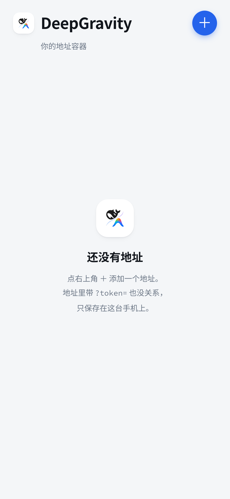
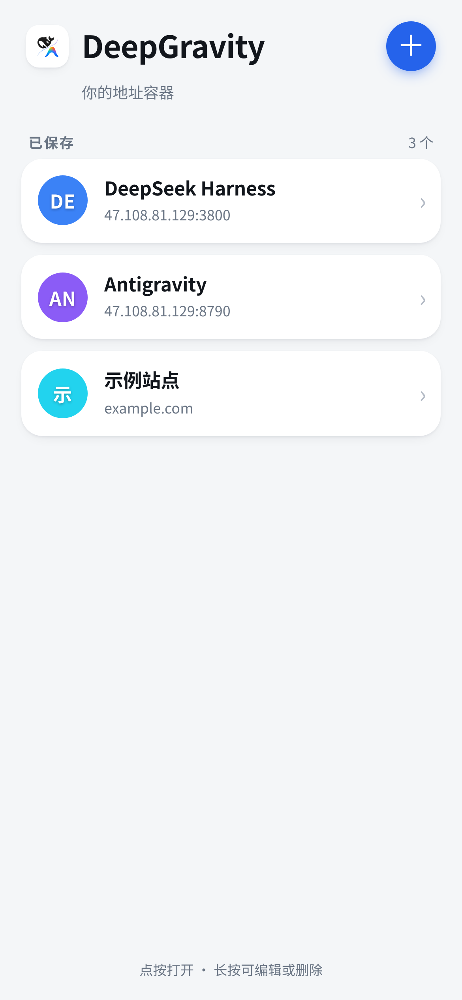
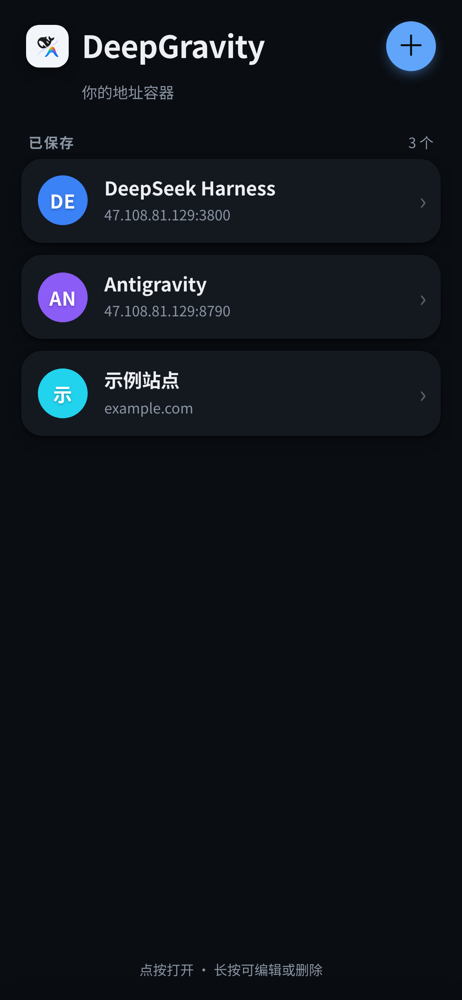
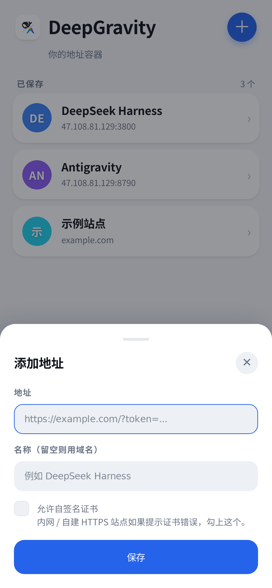

<p align="center">
  
</p>

<h1 align="center">DeepGravity</h1>

<p align="center">
  把常去的几个地址收进一个 App，点一下就打开。<br>
  不预置任何站点，地址全部由你自己添加，只存在这台手机上。
</p>

<p align="center">
  
  
  
  
</p>

---

如果你有一堆跑在内网 / 内网穿透上的 Web 服务 —— AI 工作台、自建面板、NAS、路由器后台 ——
每次都要翻浏览器书签、输 IP 和端口，很烦。这个 App 就是为这件事做的：**打开就是一张地址卡片列表，点一下全屏进入，返回就回到列表。**

它不重写任何网站，只是把系统的 WebView 包起来，**零第三方依赖，APK 只有 152 KB**。

## 截图

<p align="center">
  
  
  
</p>
<p align="center">
  
</p>

## 下载安装

去 [**Releases**](https://github.com/feicai922/webhub/releases/latest) 下载 `DeepGravity.apk`，传到手机上点开安装。

首次安装系统会提示「未知来源应用」→ 允许安装即可。

<p align="center">
  
</p>

## 使用

1. 打开 App，点右上角 **＋**
2. 填地址，例如 `https://example.com/?token=xxxx` 或 `http://192.168.1.5:8080`
   - 不写 `http://` / `https://` 会自动补：带非 443 端口的按 `http` 补，其余按 `https` 补
   - 名称留空就用域名
3. 点「保存」，卡片出现在列表里
4. 点卡片进入 → 手机返回键 / 左下角悬浮 **‹** 按钮回到列表
5. **长按卡片**可以编辑或删除

> 内网 / 自建 HTTPS 站点如果报证书错误，添加或编辑时勾上「允许自签名证书」。
> 这个放行是**按主机精确生效**的，只对你勾选过的那个主机跳过校验，其他站点照旧严格验证。

## 关于隐私

- **App 不预置任何地址**，装完是空的，别人下载同一个 APK 也看不到你的任何站点。
- 地址（含 `?token=` 这类凭证）只写在应用私有目录，其他 App 读不到；
  `allowBackup` 已关闭，不会随系统备份 / 云备份外泄。
- 卸载 App 即彻底删除。

## 技术实现

| | |
|---|---|
| 语言 | Java（纯 framework API，无 Kotlin、无 AndroidX） |
| 界面 | HTML/CSS，运行在系统 WebView 里，走 `https://app.local` 虚拟源 |
| 网页内核 | 系统自带 `android.webkit.WebView`，不额外打包 Chromium |
| 第三方依赖 | 0 |
| APK 体积 | 152 KB |
| 最低版本 | Android 8.0 (API 26) |

### 为什么界面用 HTML 而不是原生 View

因为这样一套 CSS 变量就能同时拿到浅色/深色、圆角卡片、ripple 反馈，
而且能脱离设备在 Chromium 里逐像素验证版式（Android WebView 就是 Chromium 内核）。
原生侧只剩一层很薄的 WebView 外壳。

### 几个实现细节

- **首页虚拟源**：`shouldInterceptRequest` 把 `https://app.local/*` 映射到 `assets/www/`，
  这样首页有正常的 https 源，`fetch` / `localStorage` 都能用，也不用开 `file://` 访问。
- **地址持久化**：JS 通过 `addJavascriptInterface` 暴露的 `listSites()` / `saveSites()`
  读写应用私有目录，原生侧同时重建「允许自签名证书」的主机白名单。
- **悬浮返回按钮**：进入远程页面后注入一小段 JS，用 Shadow DOM 画一个圆形返回按钮，
  不受目标网站样式影响；不想要就按系统返回键。
- **新窗口**：页面里 `target="_blank"` / `window.open` 一律在当前 WebView 内打开，不弹浏览器。
- **明文 HTTP**：已开启 `usesCleartextTraffic`，`http://` 的内网地址可以正常访问。

## 从源码构建

需要 JDK 17 + Android SDK（`compileSdk 34`）。仓库里没有 `gradlew`，用系统 `gradle` 8.x 即可。

```bash
./build.sh            # 打 release APK → dist/DeepGravity.apk
./build.sh debug      # 打 debug APK
./build.sh icons      # 从 logo/logo-抠图.png 重新生成全部图标
```

签名用的是仓库里的 `android/keystore/webhub.jks`（口令 `webhub123`，自签名，仅供侧载）。
提交它是为了让后续版本签名一致、能直接覆盖升级；**它不是有保密价值的密钥**，
但它能签这个包名，介意的话换掉即可（换了之后老版本需要卸载重装）。

## 目录结构

```
DeepGravity/
├── android/
│   ├── app/src/main/
│   │   ├── assets/www/        首页 index.html + logo（界面全部在这里）
│   │   ├── java/dev/deepgravity/MainActivity.java
│   │   └── res/               图标、浅色/深色 token、主题
│   └── keystore/webhub.jks    侧载签名密钥
├── logo/                      原始 logo 素材
├── tools/make-icons.sh        从 logo 生成 Android 图标
├── build.sh
└── dist/                      构建产物
```

## 修改界面

界面全在 `android/app/src/main/assets/www/index.html`，配色和间距是文件顶部的一组 CSS 变量：

```css
:root{
  --bg:#F4F6F8;  --surface:#FFFFFF;  --text:#12161C;
  --dim:#6B7685; --accent:#2563EB;   /* 深色值在 @media (prefers-color-scheme: dark) 里 */
}
```

改完 `./build.sh` 重新打包即可。

## License

MIT
